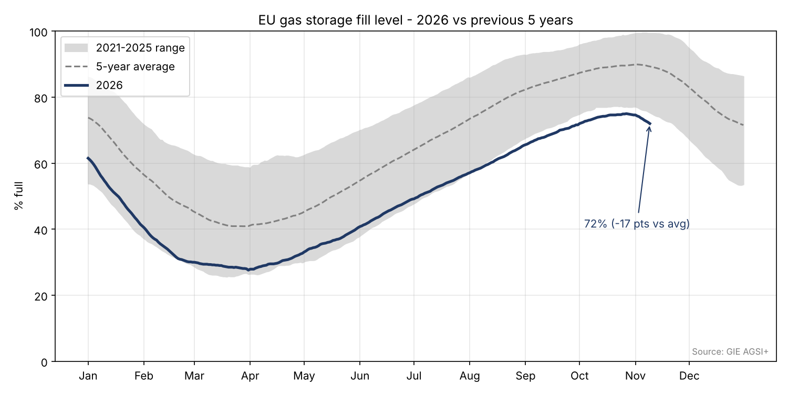

# European Gas Storage Analysis

A short Python project tracking EU natural gas storage, one of the key fundamental drivers of TTF prices.



## Key findings (data to 9 Nov 2026)
- EU storage is **72.0% full**, about **17 points below the 2021-2025 average** (89.3%) for this date.
- That is **below the lowest level of the last five years** for early November (75.3%).
- Net withdrawals have started early, at about 0.2 pts/day over the last two weeks. Even at that slow pace, storage would fall to roughly 43% by end-March. Colder weather in Dec-Feb would push it much lower.

## Why it matters
Storage is Europe's winter buffer. A deficit going into the heating season means more reliance on LNG
imports, which are already tight in 2026 (disrupted Qatari supply, EU ban on Russian LNG from January 2027).
This supports TTF prices, the winter-summer spread and gas-fired power prices.

## How it works
1. Downloads daily EU storage data from the [GIE AGSI+](https://agsi.gie.eu) API (or reads the saved CSV).
2. Computes the min / max / average fill level for each day of the year over the previous 5 years.
3. Compares the current year with that range and makes a simple end-of-winter projection.
4. Saves the chart above.

## Run it
```bash
pip install pandas matplotlib requests
python gas_storage.py            # fresh data from AGSI+
python gas_storage.py --offline  # uses eu_gas_storage_2021_2026.csv
```

## Tools
Python, pandas, matplotlib, REST API
